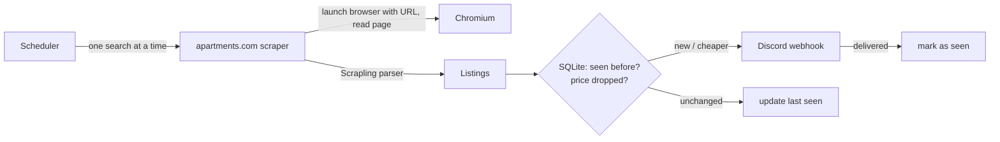

# Apartment Hunter

Watches your [apartments.com](https://www.apartments.com) searches and sends a Discord alert, with a photo, whenever a new listing appears or a listing's price drops.


- **Several searches at once**, each with its own interval and (optionally) its own Discord channel.
- **No alert flood on day one.** The first run of a search quietly records what's already listed and sends one "Now watching" message. After that you only hear about new listings and price drops.
- **Tells you when it breaks.** If a search fails 3 runs in a row (blocked, site changed, browser crashed), you get a ⚠️ message in Discord, and a ✅ when it recovers.
- **Doesn't lose alerts.** A listing is only marked as seen after Discord accepts the message, so a Discord outage just means the alert is sent on the next run.
- **Polite by default.** One search at a time, 10+ minutes between runs (±20% jitter), random 3–8 second pauses between result pages, and at most 10 pages per search.

> **Personal use only.** This tool automates a web browser to read apartments.com search results. Check apartments.com's terms of use before running it, keep the polite defaults, and use it for your own apartment search. You are responsible for how you use it.

## Quick start (uv)

You need [uv](https://github.com/astral-sh/uv) and a Chromium-family browser (Chromium, Google Chrome or Brave).

```bash
git clone https://github.com/DanXSpace/apartment-hunter
cd apartment-hunter
uv sync

cp .env.example .env                  # paste your Discord webhook URL
cp config.example.toml config.toml    # paste your apartments.com search URL

uv run apartment-hunter --once        # one run to check everything works
uv run apartment-hunter               # keep running on the schedule
```

**Getting the search URL:** on apartments.com, search your area, apply every filter you care about (price, beds, baths, pets, amenities), then copy the address bar. Map-drawn areas work too (URLs with `sk=` and `bb=`). Set a max price where you can; a search with more than 10 pages of results (~400 listings) gets cut off.

**Getting a Discord webhook:** in Discord, open the channel's settings → **Integrations** → **Webhooks** → **New Webhook** → **Copy Webhook URL**. ([Discord's guide](https://support.discord.com/hc/en-us/articles/228383668))

A Chromium window opens briefly for each page of results. That's expected; see [why a visible browser](#why-a-visible-browser).

**Quickest test:** `uv run apartment-hunter "<search URL>"` runs a single search named `default` using `DISCORD_WEBHOOK_URL` from `.env`, without a config file.

## Docker

The image runs Chromium inside a virtual display (Xvfb), so nothing appears on your screen.

```bash
cp .env.example .env
cp config.example.toml config.toml
docker compose up -d --build
docker compose logs -f
```

The database and browser profile live in `./data`, so state survives restarts and rebuilds.

## Configuration

Everything lives in `config.toml` (see [`config.example.toml`](config.example.toml) for every option with comments).

```toml
webhook_url = "${DISCORD_WEBHOOK_URL}"   # default webhook; ${VARS} come from the env / .env
interval_minutes = 15                    # minimum 10

[[search]]
name = "NJ 2BR"
url = "https://www.apartments.com/..."

[[search]]
name = "Philly"
url = "https://www.apartments.com/..."
interval_minutes = 30
webhook_url = "${PHILLY_WEBHOOK_URL}"    # send this search somewhere else
```

The search **name** is how "already seen" is tracked. Renaming a search (or giving it a new URL under a new name) starts it fresh with a silent first run.

| Command / variable | What it does |
|---|---|
| `apartment-hunter` | Run every search now, then on its interval, until stopped |
| `apartment-hunter --once` | Run every search once and exit (handy for cron or testing) |
| `apartment-hunter --alert-existing` | On a search's first run, alert on every current listing instead of recording them silently |
| `apartment-hunter -c path/to/config.toml` | Use a different config file (or set `APARTMENT_HUNTER_CONFIG`) |
| `LOG_LEVEL` | `DEBUG`, `INFO` (default), `WARNING`… |
| `BROWSER_EXECUTABLE`, `BROWSER_HEADLESS`, `BROWSER_MODE`, `BROWSER_EXTRA_ARGS`, `DATABASE_PATH` | Override the matching config values |

Upgrading from v0.1? An existing `seen_listings.txt` in the working directory is imported once on first start. The Kafka-based v0.1 is preserved at the [`v0.1-kafka`](https://github.com/DanXSpace/apartment-hunter/tree/v0.1-kafka) tag.

## Troubleshooting

**"Blocked by apartments.com bot protection (Access Denied)"**
apartments.com uses Akamai bot protection. What we've found:

- ✅ `chromium` mode, visible window (the default): works.
- ❌ Headless browsers: blocked.
- ❌ Any browser the automation *navigates* (Playwright, Scrapling's `StealthyFetcher`/`StealthySession`, CDP navigation): blocked, even with stealth options.

So keep `mode = "chromium"` and `headless = false`. If you're blocked anyway: wait a few hours (blocks are often temporary), make sure apartments.com loads in your normal browser on the same network, and avoid VPNs, which are often flagged. Deleting `data/browser-profile` resets the browser's cookies.

**"0 listings on page 1 (site layout may have changed)"**
Either the URL isn't a search results page, or apartments.com changed its page structure and the parser needs updating. Please [open an issue](https://github.com/DanXSpace/apartment-hunter/issues).

**"Stopped at the 10-page cap"**
Your search is very broad. Add a max price or other filters on apartments.com and copy the new URL.

**"Discord webhook is invalid"**
The webhook URL is wrong or was deleted. Copy it again from the channel's Integrations settings.

**"No Chromium-family browser found"**
Install Chromium, Google Chrome or Brave, or set `[browser] executable` in `config.toml` to the browser's path.

## Why a visible browser

apartments.com's bot protection rejects browsers that automation tools steer, and headless browsers. What it accepts is a normal browser that opens the search URL itself. So in `chromium` mode Apartment Hunter launches your installed browser with the search URL as a launch argument and a dedicated, persistent profile in `data/browser-profile` (not your personal profile). It then connects over the Chrome DevTools Protocol only to *read* the rendered page, which [Scrapling](https://github.com/D4Vinci/Scrapling) parses. Each results page is a separate launch.

## How it works



```
src/apartment_hunter/
├── cli.py                 # entry point: config, wiring, --once / scheduler loop
├── config.py              # config.toml + env loading and validation
├── runner.py              # one run of a search: seeding, alerts, health; scheduler
├── storage.py             # SQLite: seen listings, last price, search health
├── fetchers.py            # chromium (native launch) and stealth (Scrapling) fetchers
├── models.py              # Listing, ScrapeResult
├── scrapers/
│   └── apartments_com.py  # pagination, retries, block detection, card parsing
└── notifiers/
    └── discord.py         # embeds, rate-limit handling, webhook check
```

## Development

```bash
uv sync
uv run pytest
```

Tests never touch apartments.com or Discord. The parser is tested against a saved results page in `tests/fixtures/`. If apartments.com changes its layout, save a fresh results page there (in your browser: right-click → Save Page As → "Webpage, HTML only") and update the tests.

## License

[MIT](LICENSE)
